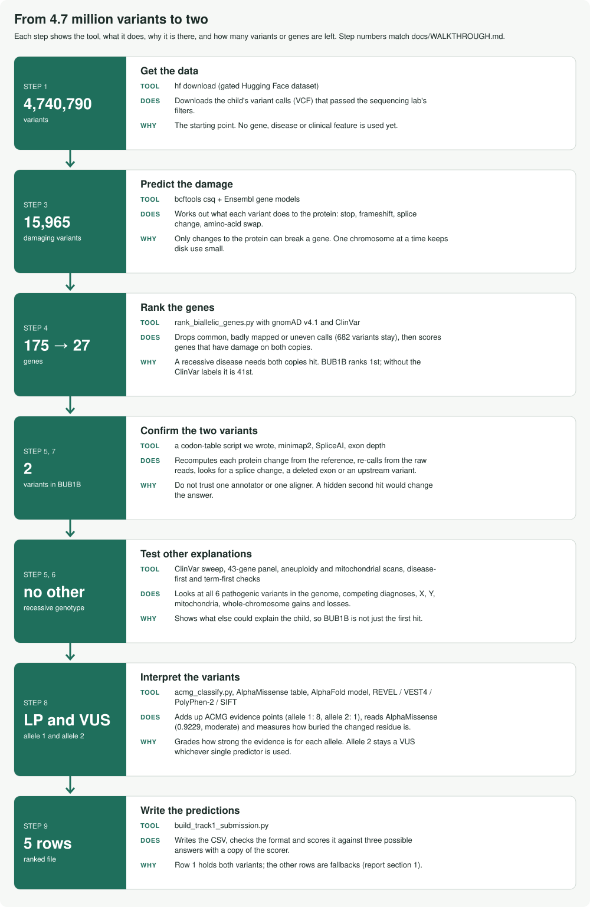

# Mosaic variegated aneuploidy: variant prediction

**"Rare Disease, Real Kid" MVA Hackathon 2026**

## The answer

Two variants in *BUB1B*, expected on different copies of the gene (compound heterozygous). They fit
mosaic variegated aneuploidy syndrome 1 (MVA1, OMIM 257300, recessive).

| | Variant (GRCh38) | Transcript `NM_001211.6` | Effect | ACMG class |
|---|---|---|---|---|
| Allele 1 | `chr15:40209701 T>G` | `c.2210T>G`, `p.Leu737Ter` | stop-gain, exon 17 of 23 | Likely pathogenic |
| Allele 2 | `chr15:40220612 T>G` | `c.3006T>G`, `p.Asn1002Lys` | missense, last exon | Uncertain significance |

We are confident in the gene and in allele 1, and less confident in allele 2. The `epcr` column (the organizers' Estimated Probability of Causal Relationship) holds ranking scores (report, section 6.1).
The full argument, the limits and the open questions are in
[`submission/report.md`](submission/report.md).

## The work in short

We started from the genome and asked which gene carries two rare damaging variants, one on each copy.
The ranking put *BUB1B* first of 175 genes. It stayed first of 27 genes with real frequencies from gnomAD
(a public database of how common each variant is), and first at all 108 settings of the filter thresholds.
The ranking uses ClinVar (a public database of variant labels); without the ClinVar labels *BUB1B* is 41st,
so the ranking needs ClinVar to identify the gene.



We then tested the answer. We searched the gene and a 170 kb window for a second variant (splice, exon
deletion, upstream region), and checked all other ClinVar pathogenic variants, named competing diagnoses,
a 43-gene panel, X, Y, mitochondria and whole-chromosome aneuploidy. We also worked backward from the
disease and from the supplied HPO terms. These checks found one explanation. We graded the two variants with the
ACMG rules (the standard guidelines for classifying variants): allele 1 is likely pathogenic and allele 2 is a
variant of uncertain significance. AlphaMissense scores allele 2 as likely pathogenic (0.92), and PolyPhen-2 and SIFT agree; under ClinGen's calibration these scores give a predictor at most 2 points, 3 with the rarity point, against the 6 needed, so allele 2 stays a variant of uncertain significance.

Phase (which copy carries each variant) is undetermined: the variants lie 10,911 bases apart, farther than any
read pair spans. The functional effect of the missense variant is unmeasured. Several claims were corrected along
the way; section 3.1 of the report covers the four stages of work, the numbers at each stage and the
changes. A flow diagram is at the top of [`docs/WALKTHROUGH.md`](docs/WALKTHROUGH.md).

## Secondary findings

A genome-wide search of ClinVar pathogenic and likely pathogenic records found five variants besides the *BUB1B* stop-gain, each heterozygous with good read support. One, in *LZTR1*, is reported as a secondary finding in the predictions file and the report (section 7), because ClinVar links it to a condition that overlaps the child's presentation. The other four lie in genes unrelated to the condition and stay unreported.

## Files

| Item | File |
|---|---|
| The report | [`submission/report.md`](submission/report.md) |
| The ranked predictions (5 rows) | [`submission/bub1b-compound-het.csv`](submission/bub1b-compound-het.csv) |
| The organizers' methods form, filled in | [`submission/methods.md`](submission/methods.md) (and `.xlsx`) |
| The output of every check | [`results/`](results/) |
| Numbers whose output file is not in `results/` yet | [`results/RECORDED-CHECKS.md`](results/RECORDED-CHECKS.md) |
| Every file in this repository and what it does | [`MANIFEST.md`](MANIFEST.md) |
| The steps in order, with run times | [`docs/WALKTHROUGH.md`](docs/WALKTHROUGH.md) |
| Tools, data and papers, with links | [`docs/references.md`](docs/references.md) |

## Rerun it

Rerunning needs your own access to the gated dataset. This repository holds code and aggregate results only.

```bash
make setup && make refs        # Python environment; public references, about 7.7 GB, about 25 minutes
./run_all.sh                   # every check, into results/
make check                     # privacy scan, lint and the offline tests
```

The main path runs on 4 vCPUs, 16 GB of memory and 30 GB of disk, using local tools only (no cloud service,
no GPU). Some checks need more disk or the raw reads; they have their own `make` targets, listed in the header
of `run_all.sh`. Run them to confirm a number in `RECORDED-CHECKS.md`.

## Scalability

The ranking takes no gene, disease or phenotype as input. The annotation step (`bcftools csq`) holds one chromosome's
reference at a time, so memory and disk stay constant as the number of genomes grows. The same scripts run on
any single-sample GRCh38 VCF.

## Results contents

The results describe the child as far as the argument needs. `scripts/public_view.py`
withholds the genotypes of genes other than the reported ones, the rsIDs of common variants,
the names of the supplied HPO terms, the names of the competing diagnoses other than the genes linked to MVA, and the list of mitochondrial variants. A rerun with the data
and the private files named at the top of `run_all.sh` produces redacted files of the same form.

## AI use

Anthropic Claude (Claude Code), commercial terms, no training on customer content, for analysis design, code,
interpretation and drafting. Details: report section 9 and the methods form.

## Licence

Submissions are released under CC BY 4.0 ([`LICENSE`](LICENSE)), as the competition rules require. The dataset keeps its own
terms, which prohibit redistribution.
